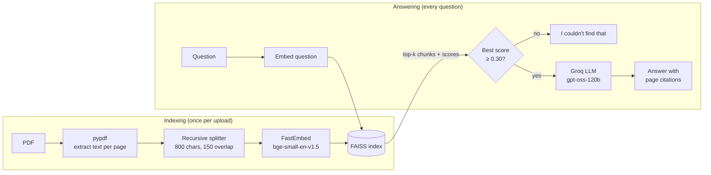

# 📄 Enterprise RAG Platform

Ask questions about your own PDFs and get answers that **cite the exact page** they came from.
Built as a Retrieval-Augmented Generation (RAG) pipeline in Python, containerised with Docker, tested in CI, and deployed live.

🔗 **Live demo:** https://enterpriserag-platform.streamlit.app/
(Comes with a sample — fictional — bank home-loan policy, so you can try it without uploading anything.)

---

## ✨ What it does

1. Upload one or more PDFs (or use the built-in sample).
2. Ask a question in plain English, e.g. *"What is the maximum loan-to-value ratio?"*
3. Get a short answer with citations like `[1]`, plus a **Sources** panel showing each retrieved passage, its file, page number and relevance score.
4. If the documents don't contain the answer, it says so instead of making something up.

## 🧠 How it works



| Step | File | What happens |
|---|---|---|
| Ingest | `rag/ingest.py` | Reads each PDF page, rejects bad files (too big, scanned, not a PDF), splits text into overlapping chunks that remember their file and page. |
| Embed & index | `rag/vectorstore.py` | Turns each chunk into a 384-number vector and stores it in FAISS. Vectors are normalised so the search score is cosine similarity (0–1). |
| Retrieve | `rag/vectorstore.py` | Embeds the question and finds the *k* closest chunks. |
| Answer | `rag/chain.py` | Guardrail first: weak matches never reach the LLM. Otherwise the LLM gets the numbered chunks and must cite them. |
| UI | `app.py` | Streamlit chat, sources panel, latency timings, per-session question limit. |

## 🛠️ Tech stack and why

| Choice | Why |
|---|---|
| **Groq · `openai/gpt-oss-120b`** | Current Groq production model (Llama 3.3 70B was retired on Groq's free tier in Aug 2026). Very fast inference, free tier. Model is set by an env var, so it can be swapped without code changes. |
| **FastEmbed · `BAAI/bge-small-en-v1.5`** | Embeddings run locally on CPU (ONNX) — no API key, no per-call cost, and documents never leave the server to be embedded. |
| **FAISS (`IndexFlatIP`)** | Exact vector search, milliseconds for thousands of chunks. For millions of chunks, switch to an approximate index (HNSW/IVF). |
| **LangChain core + text splitters** | Standard interfaces (`Document`, `Embeddings`, chat models) so each part can be swapped and tested with fakes. |
| **Streamlit** | Quick, shareable UI with free hosting on Streamlit Community Cloud. |
| **Docker** | The same image runs on any laptop or cloud (AWS ECS/App Runner, Azure Container Apps, GCP Cloud Run). Runs as a non-root user, has a health check, and bakes in the embedding model. |
| **pytest + GitHub Actions** | 12 tests (ingestion, retrieval, guardrail, and a UI smoke test) run on every push using fake embeddings and a fake LLM, so CI needs no API key. CI also builds the Docker image and checks it starts healthy. |

## 🛡️ Production touches

- **Grounded answers only:** relevance threshold + strict prompt → says *"I couldn't find that"* instead of hallucinating.
- **Citations you can check:** every answer shows the source passages, page numbers and scores.
- **Input validation:** file-size, page-count, non-PDF and scanned-PDF checks with clear messages.
- **Cost protection:** per-session question limit; weak matches skip the LLM call entirely.
- **Secrets never in code:** API key from Streamlit secrets or environment variables.
- **Caching:** the embedding model loads once per server; re-uploading the same files doesn't re-embed them.
- **Observability:** structured logs of each question, best relevance score and latency.

## 🔌 REST API (FastAPI)

The same RAG pipeline also runs as a REST API, so other apps (a website, a mobile app, another team's service) can use it without the Streamlit UI. Interactive docs are at `/docs`.

| Endpoint | Method | What it does |
| -------- | ------ | ------------ |
| `/health` | GET | Liveness check. Docker's healthcheck calls it every 30 s. |
| `/ask` | POST | Takes `{"question": "...", "top_k": 4}` and returns the answer, its sources (file, page, relevance score) and latency. |
| `/stats` | GET | Total questions, errors, "not found" count and average latency, from the query log. |

**Example**

```bash
curl -X POST http://localhost:8000/ask \
  -H "Content-Type: application/json" \
  -d '{"question": "What is the maximum loan-to-value ratio?", "top_k": 4}'
```

```json
{
  "answer": "The highest loan-to-value (LTV) ratio allowed is up to 90% for loans up to Rs 30 lakh [2].",
  "sources": [{"source": "northwind_home_loan_policy.pdf", "page": 1, "score": 0.76}],
  "latency_sec": 1.26
}
```

**How it's built**
- **Index built once at startup** (FastAPI `lifespan`), not on every request.
- **Pydantic validation:** bad input (e.g. an empty question) is rejected with `422` before any code runs.
- **Query log:** every request is saved to SQLite with its latency, best relevance score and status (`success`, `not_found` or `error`). Queries use parameterised SQL.
- **Clean failures:** if the LLM call fails, the API returns `503` and the full traceback goes to the logs.

## 🚀 Run it

**1. Locally**
```bash
python -m venv .venv && source .venv/bin/activate   # Windows: .venv\Scripts\activate
pip install -r requirements.txt
cp .streamlit/secrets.toml.example .streamlit/secrets.toml   # then paste your Groq key
streamlit run app.py
```

**2. With Docker**
```bash
cp .env.example .env          # then paste your Groq key
docker compose up --build     # open http://localhost:8501
```

**3. Tests**
```bash
pip install -r requirements-dev.txt
pytest -v
```
**2. With Docker (UI + API)**
```
cp .env.example .env          # then paste your Groq key
docker compose up --build     # UI: http://localhost:8501 · API: http://localhost:8000/docs
```
Two services start from the same image: `rag` (Streamlit) and `api` (FastAPI). The API has a healthcheck on `/health`, and its query log is stored on a named Docker volume, so the data survives `docker compose down`.

**3. API only (without Docker)**
```
set GROQ_API_KEY=your_key            # Mac/Linux: export GROQ_API_KEY=your_key
uvicorn api.main:app --reload
```

## ⚙️ Configuration

All settings live in `rag/config.py` and can be overridden with environment variables:
`GROQ_MODEL`, `EMBED_MODEL`, `CHUNK_SIZE`, `CHUNK_OVERLAP`, `TOP_K`, `MIN_RELEVANCE`, `MAX_FILE_MB`, `MAX_PAGES`, `MAX_QUESTIONS_PER_SESSION`.

## 🔭 Limitations and next steps

- The index lives in memory per user session; a persistent vector database (e.g. pgvector) would let documents survive restarts.
- Each question is answered on its own; follow-ups like *"what about the second one?"* would need query rewriting from chat history.
- Scanned PDFs need OCR.
- Next: hybrid search (keyword + vector) and a re-ranker, plus an evaluation set to measure retrieval quality.
- The API currently indexes the bundled sample PDF; an upload endpoint is the next step.
- SQLite is a single file on one server; with several API replicas the log would move to Postgres.
